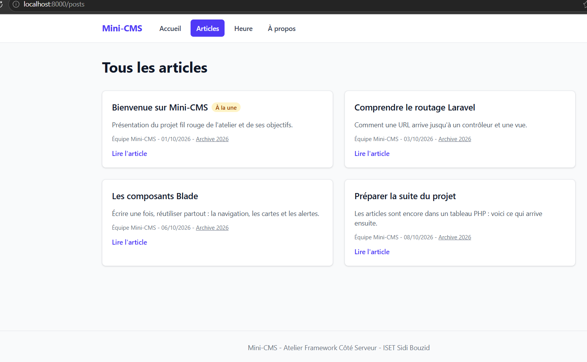

## État actuel (tag lab-02b)

- Pages construites avec des composants Blade anonymes : `x-navbar`, `x-nav-link`, `x-post-card`, `x-alert`, `x-page-header`.
- Lien actif dans la navigation avec `request()->routeIs()`.
- Articles toujours stockés dans un tableau PHP, sans base de données pour l'instant.

## Routes disponibles

| Méthode | URI | Nom | Action |
|---|---|---|---|
| GET | `/` | `home` | `PageController@home` |
| GET | `/a-propos` | `about` | `PageController@about` |
| GET | `/heure` | `time` | `PageController@time` |
| GET | `/posts` | `posts.index` | `PostController@index` |
| GET | `/posts/archive/{year}` | `posts.archive` | `PostController@archive` |
| GET | `/posts/{slug}` | `posts.show` | `PostController@show` |

### Accueil avec le layout

### Liste des articles

### Détail d'un article

### Session 04

