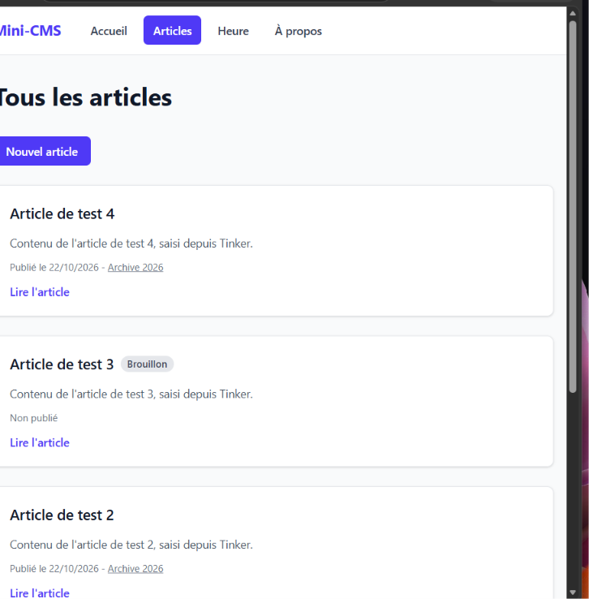
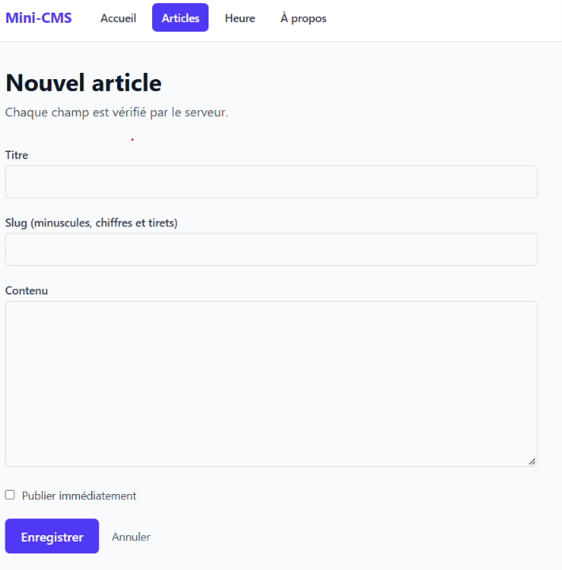

## État actuel (tag lab-03)

- Articles enregistrés dans une base SQLite et lus avec le modèle Eloquent `Post`.
- Table `posts` créée par une migration : après un clone, `php artisan migrate` la recrée (vide).
- Liste paginée, détail par liaison modèle-route, formulaire de création avec validation côté serveur.
- Premiers tests Pest : `php artisan test`.

## Routes disponibles

| Méthode | URI | Nom | Action |
|---|---|---|---|
| GET | `/` | `home` | `PageController@home` |
| GET | `/a-propos` | `about` | `PageController@about` |
| GET | `/heure` | `time` | `PageController@time` |
| GET | `/posts` | `posts.index` | `PostController@index` |
| GET | `/posts/archive/{year}` | `posts.archive` | `PostController@archive` |
| GET | `/posts/create` | `posts.create` | `PostController@create` |
| POST | `/posts` | `posts.store` | `PostController@store` |
| GET | `/posts/{post}` | `posts.show` | `PostController@show` |
### Session 05

