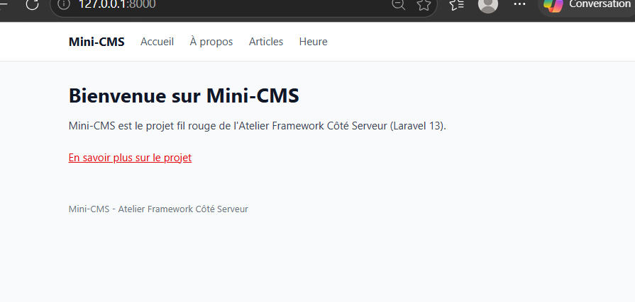
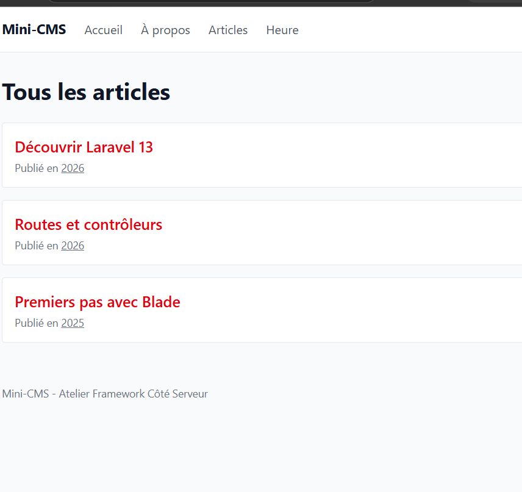
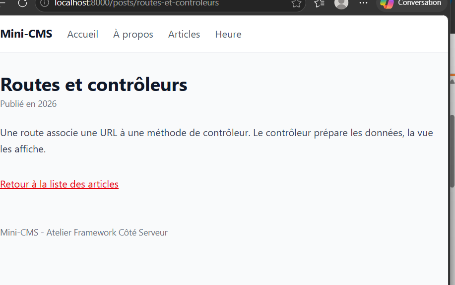

## État actuel (tag lab-02)

- Routes nommées, toutes servies par des contrôleurs : `PageController` (pages) et `PostController` (articles).
- Articles stockés dans un tableau PHP, sans base de données pour l'instant.
- Layout Blade `<x-layout>` avec Tailwind chargé par Vite.
- Base de données SQLite locale (`database/database.sqlite`, non versionnée).

## Routes disponibles

| Méthode | URI | Nom | Action |
|---|---|---|---|
| GET | `/` | `home` | `PageController@home` |
| GET | `/a-propos` | `about` | `PageController@about` |
| GET | `/heure` | `time` | `PageController@time` |
| GET | `/posts` | `posts.index` | `PostController@index` |
| GET | `/posts/archive/{year}` | `posts.archive` | `PostController@archive` |
| GET | `/posts/{slug}` | `posts.show` | `PostController@show` |

### Accueil avec le layout

### Liste des articles

### Détail d'un article

